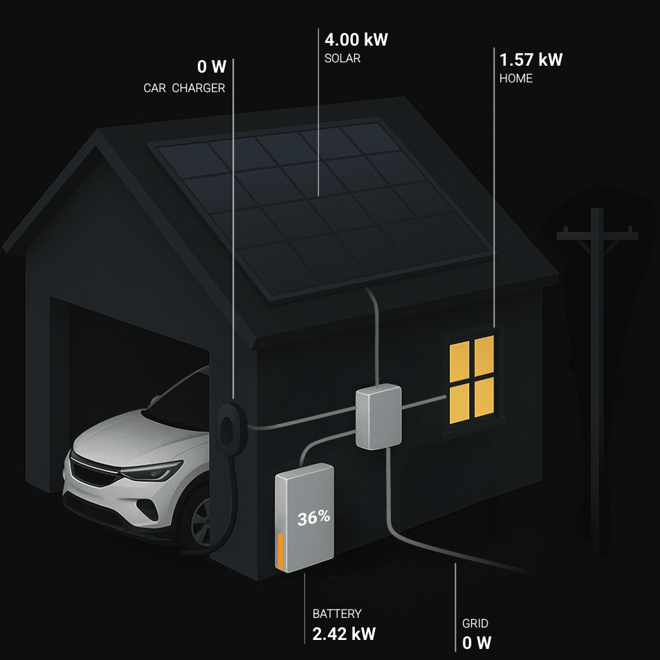

# 🌞 Home Assistant Modern Solar Energy Card 

[](https://opensource.org/licenses/MIT)
[]()

A sleek, modern-looking live dashboard for solar energy monitoring in Home Assistant. This card provides a Tesla-inspired interface for visualizing your home's energy flow including:

- 🔆 **Solar Generation** - Real-time power produced by your solar panels
- 🏠 **Home Consumption** - Current electricity usage in your home
- 🔌 **Grid Exchange** - Power drawn from or exported to the grid
- ⚡ **Battery Storage** - Battery state of charge, charging/discharging power and animated flow
- 🚗 **EV Charger** - Car charger power consumption and animated flow

## ✨ Preview v2



## 📋 Features

- **Real-time Updates**: Live visualization of power flow between solar panels, home, grid, battery, and EV charger
- **Battery Monitoring**: State of charge percentage with a color-coded progress bar (green → yellow → orange → red) and charge/discharge power display
- **EV Charger Visualization**: Real-time car charger power consumption with animated flow
- **Animated Power Flow**: Directional pulse animations for solar-to-inverter, inverter-to-house, inverter-to-grid, grid-to-house, inverter-to-battery, battery-to-inverter, and inverter-to-charger paths
- **Smart Visibility**: Flow animations automatically show/hide based on current power state (e.g. grid export pulse only appears when exporting)
- **Automatic Unit Conversion**: Displays values in W or kW depending on magnitude
- **Responsive Design**: Adapts to different screen sizes
- **Modern UI**: Clean, intuitive interface inspired by Tesla's battery app

## 📦 Requirements

- Home Assistant
- [ha-floorplan](https://experiencelovelace.github.io/ha-floorplan/) card (installable via HACS)
- Solar power generation and consumption sensors
- Battery storage sensors (for battery features)
- EV charger power sensor (for charger features)

## 🚀 Installation

1. Install the [ha-floorplan](https://experiencelovelace.github.io/ha-floorplan/) card using HACS
2. Download this repository and copy files to your Home Assistant configuration folder:
    (you can choose your own folder if you like)
   ```
   /config/www/custom-lovelace/energy/
   ```
3. Update `hasolardashboard.yml` with your sensor entities
4. Add the card to your lovelace dashboard as below. 
    ```
          - type: custom:floorplan-card
            config: /local/custom-lovelace/energy/hasolardashboard.yml
    ```

## ⚙️ Configuration

Edit the `hasolardashboard.yml` file and replace the sensor entities with your own:

### Core Sensors

- `sensor.power_consumption`: Your home electricity usage sensor
- `sensor.solar_generation`: Your solar production sensor
- `sensor.grid_power`: Your grid import/export sensor

### Battery Sensors (new in v2)

- `sensor.sigen_plant_battery_state_of_charge`: Your battery state of charge sensor (0–100%)
- `sensor.battery_power`: Your battery charge/discharge power sensor (positive = charging, negative = discharging)

### EV Charger Sensor (new in v2)

- `sensor.car_charger_power`: Your EV charger power sensor

### SVG Element Reference

The v2 SVG (`hasolardashboard-modenhouse-v2.svg`) contains the following key elements used by the YAML rules:

| Element ID | Description |
|---|---|
| `solar_value_text` | Solar generation power value |
| `power_value_text` | Home consumption power value |
| `grid_value_text` | Grid import/export power value |
| `battery_soc_text` | Battery state of charge (%) |
| `battery_w_text` | Battery charge/discharge power value |
| `car_charger_w_value_text` | EV charger power value |
| `battery_soc_bar` | Color-coded battery SOC progress bar |
| `solar_to_inverter` | Solar → inverter pulse animation |
| `solar-inverter-to-house` | Inverter → house pulse (solar path) |
| `inverter-to-charger` | Inverter → EV charger pulse animation |
| `inverter-to-battery` | Inverter → battery pulse (charging) |
| `battery-to-inverter` | Battery → inverter pulse (discharging) |
| `pulse-from-inverter-to-grid` | Inverter → grid pulse (exporting) |
| `pulse-from-grid` | Grid → inverter pulse (importing) |
| `pulse-from-inverter-to-house` | Inverter → house pulse (grid path) |

## 🛣️ Roadmap

- ~~⚡ **Battery Visualization**: Support for home battery storage systems~~ ✅ Added in v2.0
- ~~🚗 **EV Charger Integration**: Visualize car charging status and power flow~~ ✅ Added in v2.0
- 📊 **Historical Data**: View energy production summary of the day

## 📦 Versioning

This project follows [Semantic Versioning](https://semver.org/):

- **Current Version**: 2.0 (Released: April 2026)
- **Previous Version**: 1.0 (Released: June 2025)
- **Update Method**: Check this repository for new releases or subscribe to release notifications
- **Changelog**: See [CHANGELOG.md](CHANGELOG.md) for detailed version history and changes

## 📄 License

This project is licensed under the MIT License - see the [LICENSE](LICENSE) file for details.